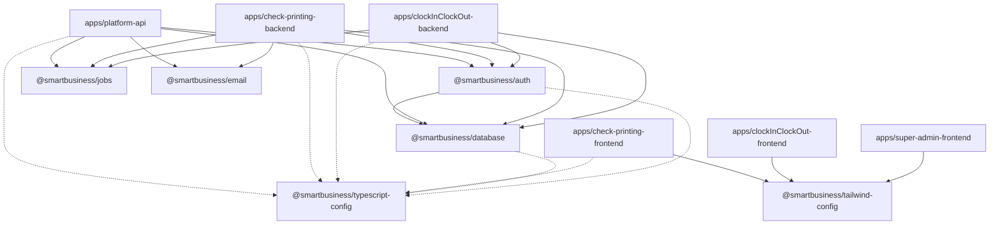

# SmartBusiness Solutions — Enterprise Monorepo

> **Multi-Tenant B2B SaaS Platform** powered by Turborepo, pnpm Workspaces, Express.js (ESM), PostgreSQL, Prisma 7, Python AI services, and modern React 19 frontends.

---

## 📚 Master Documentation Map

Navigate all architectural documentation, engineering standards, application specs, and package guides across the monorepo:

### 🏛️ Core Platform & Architecture Guides

| Document | Location | Purpose |
| :--- | :--- | :--- |
| **System Architecture & Boundaries** | [`docs/ARCHITECTURE.md`](./docs/ARCHITECTURE.md) | In-depth system architecture, service topology, multi-tenancy, security guards, and data flows |
| **Monorepo Directory & Structure Map** | [`docs/STRUCTURE.md`](./docs/STRUCTURE.md) | Exhaustive directory tree, application catalog, package manifest, and port assignments |
| **Project Knowledge Base** | [`PROJECT_KNOWLEDGE.md`](./PROJECT_KNOWLEDGE.md) | Monorepo cheatsheet, domain models, seed credentials, and conventions |
| **Strict Architectural & Coding Guidance** | [`STRICT_GUIDELINES.md`](./STRICT_GUIDELINES.md) | Mandatory 5-tier backend rules, multi-tenancy guards, security standards, and commit checklist |

---

### 🚀 Applications (`apps/`)

| Application | Port / Tech | Documentation | Description |
| :--- | :--- | :--- | :--- |
| **`platform-api`** | `3001` · Express + TS (ESM) | [`apps/platform-api/README.md`](./apps/platform-api/README.md) | Centralized identity, multi-tenant onboarding, JWT sessions, MFA, and BullMQ email worker |
| **`check-printing-backend`** | `3005` · Express + TS (ESM) | [`apps/check-printing-backend/README.md`](./apps/check-printing-backend/README.md) | Check printing, AES-256-GCM encrypted bank accounts, payees, approvals, and PDF generation |
| **`clockInClockOut-backend`** | `3000` · Express + TS (ESM) | [`apps/clockInClockOut-backend/README.md`](./apps/clockInClockOut-backend/README.md) | Time & attendance tracking, Haversine geofencing, shifts, and biometric face match integration |
| ↳ _Attendance API Specs_ | - | [`apps/clockInClockOut-backend/ATTENDANCE_API_ENDPOINTS.md`](./apps/clockInClockOut-backend/ATTENDANCE_API_ENDPOINTS.md) | REST API specification for admin attendance reporting, rosters, and analytics |
| ↳ _Architecture Review_ | - | [`apps/clockInClockOut-backend/CHECKPOINT_BACKEND_REVIEW.md`](./apps/clockInClockOut-backend/CHECKPOINT_BACKEND_REVIEW.md) | Deep architectural review and migration plan from legacy Checkpoint to SmartBusiness standard |
| **`clockInClockOut-frontend`** | `5174` · React 19 + MUI + Tailwind v4 | [`apps/clockInClockOut-frontend/README.md`](./apps/clockInClockOut-frontend/README.md) | Employee attendance web application with webcam burst capture and admin portal |
| **`check-printing-frontend`** | `5173` · React 19 + Vite + Tailwind v4 | [`apps/check-printing-frontend/README.md`](./apps/check-printing-frontend/README.md) | Client customer-facing check printing portal |
| **`super-admin-frontend`** | `3004` · React 19 + Vite + Tailwind v4 | [`apps/super-admin-frontend/README.md`](./apps/super-admin-frontend/README.md) | Platform super-admin console for organizations, subscriptions, and developer telemetry |
| **`platform-web`** | `3003` · React 19 + Vite + Tailwind v4 | [`apps/platform-web/README.md`](./apps/platform-web/README.md) | Platform marketing website and customer onboarding portal |
| **`clockInClockout-face-recognition`** | `8000` · Python FastAPI + InsightFace | [`apps/clockInClockout-face-recognition/README.MD`](./apps/clockInClockout-face-recognition/README.MD) | Biometric facial recognition, anti-spoofing challenge/burst liveness verification |
| **`chatbot-backend`** | `8001` · Python FastAPI + pgvector | [`apps/chatbot-backend/README.md`](./apps/chatbot-backend/README.md) | RAG support assistant backend with NeMo guardrails, pgvector retrieval, and Groq LLM |
| **`chatbot-frontend`** | `5175` · React 18 + Vite + Tailwind v3 | [`apps/chatbot-frontend/README.md`](./apps/chatbot-frontend/README.md) | Chatbot admin console for document ingestion and chat inspection |

---

### 📦 Shared Packages (`packages/`)

| Package | Package Name | Documentation | Description |
| :--- | :--- | :--- | :--- |
| **`database`** | `@smartbusiness/database` | [`packages/database/README.md`](./packages/database/README.md) | Prisma 7 ORM schema, migrations, connection pool (`@prisma/adapter-pg`), and seed scripts |
| **`auth`** | `@smartbusiness/auth` | [`packages/auth/README.md`](./packages/auth/README.md) | Shared JWT token service, Argon2id password hashing, and Express middleware chain |
| **`email`** | `@smartbusiness/email` | [`packages/email/README.md`](./packages/email/README.md) | Transactional email delivery senders (SMTP/SES/File) and HTML templates |
| **`jobs`** | `@smartbusiness/jobs` | [`packages/jobs/README.md`](./packages/jobs/README.md) | BullMQ queue wrappers, workers, and Redis connection management |
| **`tailwind-config`** | `@smartbusiness/tailwind-config` | [`packages/tailwind-config/README.md`](./packages/tailwind-config/README.md) | Canonical CSS design tokens, color palettes, and typography tokens |
| **`typescript-config`** | `@smartbusiness/typescript-config` | [`packages/typescript-config/README.md`](./packages/typescript-config/README.md) | Shared TypeScript compiler presets (`base.json`, `nextjs.json`, `react-library.json`) |
| **`eslint-config`** | `@repo/eslint-config` | [`packages/eslint-config/README.md`](./packages/eslint-config/README.md) | Shared ESLint configurations across workspaces |

---

## 🏗️ Architecture Overview

SmartBusiness Solutions is designed around logical tenant isolation on a shared PostgreSQL cluster with product decoupling via Turborepo:

```
smartbusiness-solution/
├── package.json                   # Root package script definitions
├── pnpm-workspace.yaml            # pnpm workspace declaration (apps/*, packages/*)
├── turbo.json                     # Turborepo task pipeline configuration
├── README.md                      # Monorepo Master Documentation Index (This file)
├── PROJECT_KNOWLEDGE.md           # Deep Domain Models, Flows & Test Credentials
├── STRICT_GUIDELINES.md           # Mandatory 5-Tier Architecture & Coding Standards
│
├── apps/
│   ├── platform-api/              # Identity, Auth, Tenants, Sessions, Worker (Port 3001)
│   ├── check-printing-backend/    # Check Printing & Financial Microservice (Port 3005)
│   ├── clockInClockOut-backend/   # Time & Attendance Microservice (Port 3000)
│   ├── clockInClockout-face-recognition/ # Facial Verification Service (Port 8000)
│   ├── chatbot-backend/           # RAG AI Chatbot (Port 8001 / 8000)
│   ├── check-printing-frontend/   # Customer Check Printing Portal (Port 5173)
│   ├── clockInClockOut-frontend/  # Attendance Web Client (Port 5174)
│   ├── platform-web/              # Platform Marketing Website (Port 3003)
│   ├── super-admin-frontend/      # Platform Super Admin Console (Port 3004)
│   └── chatbot-frontend/          # Chatbot Admin Console (Port 5175)
│
├── docker/
│   ├── Dockerfile.gateway         # Nginx Gateway container definition
│   └── nginx.conf                 # Unified reverse proxy routing table (:80 / :443)
│
└── packages/
    ├── database/                  # Prisma 7 Schema, Migrations, Seed Scripts
    ├── auth/                      # Shared Auth Primitives & Middleware Pipeline
    ├── email/                     # Transactional Email Senders & Templates
    ├── jobs/                      # BullMQ Queues & Background Workers
    ├── tailwind-config/           # Global Design Tokens & CSS Themes
    ├── typescript-config/         # Standardized tsconfig Presets
    └── eslint-config/             # Standardized ESLint Rules
```

### Core Dependency Graph



---

## ⚡ Quickstart & Development

### 1. Prerequisites

- **Node.js:** `>= 20.0.0`
- **pnpm:** `11.x` (`corepack enable pnpm`)
- **PostgreSQL:** `>= 15` with `pgvector` extension enabled
- **Python:** `>= 3.10` (required for `clockInClockout-face-recognition` and `chatbot-backend`)
- **Docker:** for Redis, Mailpit, and containerized services

### 2. Installation

```bash
# Clone and install dependencies
pnpm install
```

### 3. Database Generation & Seeding

```bash
# Generate Prisma 7 Client
pnpm run --filter @smartbusiness/database generate

# Run Prisma Migrations
pnpm run --filter @smartbusiness/database db:migrate:dev

# Seed master test data (Green Acres Landscaping, Sunshine Pool, test checks)
pnpm run --filter @smartbusiness/database db:seed

# Seed attendance geofencing, employee profiles & historical punches
pnpm run --filter @smartbusiness/database seed:attendance
```

### 4. Running the Monorepo

```bash
# Start backing dev containers (Redis on 6379, Mailpit on 1025/8025, Face Recognition on 8000)
pnpm docker:dev

# Start all apps concurrently in development mode
pnpm dev

# Or run a specific application
pnpm --filter @smartbusiness/platform-api dev
pnpm --filter @smartbusiness/check-printing-backend dev
pnpm --filter @smartbusiness/clockInClockOut-backend dev
pnpm --filter @smartbusiness/check-printing-frontend dev
pnpm --filter @smartbusiness/clockInClockOut-frontend dev
pnpm --filter @smartbusiness/super-admin-frontend dev
```

### 5. Type Checking & Code Quality

```bash
# Verify TypeScript types across all packages and apps without emitting code
pnpm check-types

# Run ESLint across all workspaces
pnpm lint

# Format code with Prettier
pnpm format
```

---

## 🔑 Test Credentials (Local Development)

The database includes deterministic test seeds with static UUIDs for local testing:

| Email | Password | Tenant / Company | Primary Roles |
| :--- | :--- | :--- | :--- |
| `maria@greenacres.com` | `Password1!` | Green Acres Landscaping LLC | Tenant `OWNER`, `check-admin` |
| `jennifer@greenacres.com` | `Password1!` | Green Acres Landscaping LLC | `check-editor`, `check-printer` |
| `david@greenacres.com` | `Password1!` | Green Acres & Sunshine Pool | `check-editor`, `check-approver` |
| `sarah@sunshinepool.com` | `Password1!` | Sunshine Pool Service | Tenant `OWNER`, `check-admin` |

_For complete seed data mappings, static UUIDs, and API payloads, see [`PROJECT_KNOWLEDGE.md`](./PROJECT_KNOWLEDGE.md)._

---

## 🛡️ Engineering Standards Checklist

All contributions must comply with [`STRICT_GUIDELINES.md`](./STRICT_GUIDELINES.md):

- [x] **5-Tier Architecture:** Routes $\rightarrow$ Controllers $\rightarrow$ Services $\rightarrow$ Repositories $\rightarrow$ Prisma. No direct DB calls in controllers.
- [x] **Strict Multi-Tenancy:** All entity queries must be filtered by `tenantId` and/or `workspaceId`.
- [x] **ESM Extension Rule:** All relative TypeScript imports must specify the `.js` extension (e.g. `import { foo } from "./foo.js"`).
- [x] **No Cross-App Imports:** Code in `apps/A` may never import from `apps/B`. Shared logic lives in `packages/`.
- [x] **Financial Secrets:** Bank routing and account numbers are encrypted with AES-256-GCM and masked on API responses.
- [x] **No Plain `console.log`:** Use structured Pino logging with `requestId` correlation.
