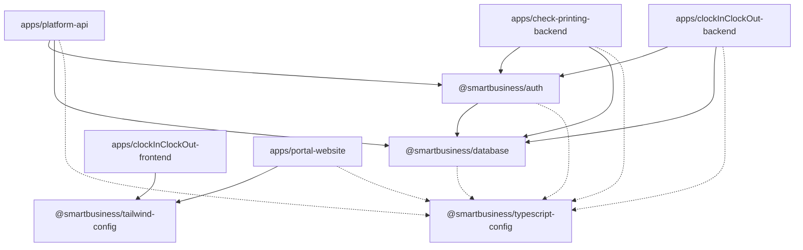

# SmartBusiness Solutions — Enterprise Monorepo

> **Multi-Tenant B2B SaaS Platform** powered by Turborepo, pnpm Workspaces, Express.js (ESM), PostgreSQL, Prisma 7, and modern React 19 frontends.

---

## 📚 Master Documentation Map

Navigate all architectural documentation, engineering standards, application specs, and package guides across the monorepo:

### 🏛️ Core Platform & Architecture Guides

| Document                                   | Location                                         | Purpose                                                                                        |
| :----------------------------------------- | :----------------------------------------------- | :--------------------------------------------------------------------------------------------- |
| **Monorepo Architecture & Knowledge Base** | [`PROJECT_KNOWLEDGE.md`](./PROJECT_KNOWLEDGE.md) | In-depth system architecture, database domain models, auth flows, and seed credentials         |
| **Strict Architectural & Coding Guidance** | [`STRICT_GUIDELINES.md`](./STRICT_GUIDELINES.md) | Mandatory 5-tier backend rules, multi-tenancy guards, security standards, and commit checklist |

---

### 🚀 Applications (`apps/`)

| Application                    | Port / Tech                            | Documentation                                                                                                              | Description                                                                                   |
| :----------------------------- | :------------------------------------- | :------------------------------------------------------------------------------------------------------------------------- | :-------------------------------------------------------------------------------------------- |
| **`platform-api`**             | `3001` · Express + TS (ESM)            | [`apps/platform-api/README.md`](./apps/platform-api/README.md)                                                             | Centralized identity, multi-tenant onboarding, JWT sessions, and subscription lifecycle       |
| **`check-printing-backend`**   | `3005` · Express + TS (ESM)            | [`apps/check-printing-backend/README.md`](./apps/check-printing-backend/README.md)                                         | Check printing, AES-256-GCM encrypted bank accounts, payees, and multi-tier approval workflow |
| **`clockInClockOut-backend`**  | `3000` · Express + TS (ESM)            | [`apps/clockInClockOut-backend/README.md`](./apps/clockInClockOut-backend/README.md)                                       | Time & attendance tracking, Haversine geofencing, and biometric face match integration        |
| ↳ _Attendance API Specs_       | -                                      | [`apps/clockInClockOut-backend/ATTENDANCE_API_ENDPOINTS.md`](./apps/clockInClockOut-backend/ATTENDANCE_API_ENDPOINTS.md)   | REST API specification for admin attendance reporting, rosters, and analytics                 |
| ↳ _Architecture Review_        | -                                      | [`apps/clockInClockOut-backend/CHECKPOINT_BACKEND_REVIEW.md`](./apps/clockInClockOut-backend/CHECKPOINT_BACKEND_REVIEW.md) | Deep architectural review and migration plan from legacy Checkpoint to SmartBusiness standard |
| **`clockInClockOut-frontend`** | `Vite` · React 19 + MUI + Tailwind     | [`apps/clockInClockOut-frontend/README.md`](./apps/clockInClockOut-frontend/README.md)                                     | Employee attendance web application with webcam selfie capture and admin portal               |
| **`portal-website`**           | `5173` · React 19 + Vite + Tailwind v4 | [`apps/portal-website/README.md`](./apps/portal-website/README.md)                                                         | Client customer-facing portal consuming platform design tokens                                |
| **`face-recognition`**         | `8000` · Python FastAPI + DeepFace     | [`apps/face-recognition/README.MD`](./apps/face-recognition/README.MD)                                                     | Biometric facial recognition, liveness verification, and 2-image cosine similarity service    |
| **`rag-chatbot`**              | `FastAPI` + pgvector + Redis           | [`apps/rag-chatbot/README.md`](./apps/rag-chatbot/README.md) · [`PROJECT.md`](./apps/rag-chatbot/PROJECT.md)               | Retrieval-augmented support chatbot backend with embeddable vanilla JS widget                 |
| **`web-portal`**               | `Vite` · React 19 + Gemini API         | [`apps/web-portal/README.md`](./apps/web-portal/README.md)                                                                 | AI Studio prototype portal interface                                                          |

---

### 📦 Shared Packages (`packages/`)

| Package                 | Package Name                       | Documentation                                                                    | Description                                                                               |
| :---------------------- | :--------------------------------- | :------------------------------------------------------------------------------- | :---------------------------------------------------------------------------------------- |
| **`database`**          | `@smartbusiness/database`          | [`packages/database/README.md`](./packages/database/README.md)                   | Prisma 7 ORM schema, migrations, connection pool (`@prisma/adapter-pg`), and seed scripts |
| **`auth`**              | `@smartbusiness/auth`              | [`packages/auth/README.md`](./packages/auth/README.md)                           | Shared JWT token service, Argon2id password hashing, and Express middleware chain         |
| **`tailwind-config`**   | `@smartbusiness/tailwind-config`   | [`packages/tailwind-config/README.md`](./packages/tailwind-config/README.md)     | Canonical CSS design tokens, color palettes, and typography tokens                        |
| **`typescript-config`** | `@smartbusiness/typescript-config` | [`packages/typescript-config/README.md`](./packages/typescript-config/README.md) | Shared TypeScript compiler presets (`base.json`, `nextjs.json`, `react-library.json`)     |
| **`eslint-config`**     | `@smartbusiness/eslint-config`     | [`packages/eslint-config/README.md`](./packages/eslint-config/README.md)         | Shared ESLint configurations across workspaces                                            |

---

## 🏗️ Architecture Overview

SmartBusiness Solutions is designed around logical tenant isolation on a shared PostgreSQL cluster with product decoupling via Turborepo:

```
smartbusiness-solution/
├── package.json                   # Root package script definitions
├── pnpm-workspace.yaml            # pnpm workspace declaration (apps/*, packages/*)
├── turbo.json                     # Turborepo task pipeline configuration
├── README.md                      # Monorepo Master Documentation Index (This file)
├── PROJECT_KNOWLEDGE.md           # Deep Domain Models, Flows & Test Credentials
├── STRICT_GUIDELINES.md           # Mandatory 5-Tier Architecture & Coding Standards
│
├── apps/
│   ├── platform-api/              # Identity, Auth, Tenants, Sessions (Port 3001)
│   ├── check-printing-backend/    # Check Printing & Financial Microservice (Port 3005)
│   ├── clockInClockOut-backend/   # Time & Attendance Microservice (Port 3000)
│   ├── clockInClockOut-frontend/  # Attendance Web Client (Vite + React 19)
│   ├── portal-website/            # Customer Portal (Vite + React 19 + Tailwind v4)
│   ├── face-recognition/          # Facial Verification Service (Python FastAPI)
│   ├── rag-chatbot/               # RAG AI Chatbot (FastAPI + pgvector + Redis)
│   └── web-portal/                # AI Studio Prototype Portal
│
└── packages/
    ├── database/                  # Prisma 7 Schema, Migrations, Seed Scripts
    ├── auth/                      # Shared Auth Primitives & Middleware Pipeline
    ├── tailwind-config/           # Global Design Tokens & CSS Themes
    ├── typescript-config/         # Standardized tsconfig Presets
    └── eslint-config/             # Standardized ESLint Rules
```

### Core Dependency Graph



---

## ⚡ Quickstart & Development

### 1. Prerequisites

- **Node.js:** `>= 20.0.0`
- **pnpm:** `11.x` (`corepack enable pnpm`)
- **PostgreSQL:** `>= 15` with `pgvector` extension enabled
- **Python:** `>= 3.10` (required for `face-recognition` and `rag-chatbot`)

### 2. Installation

```bash
# Clone and install dependencies
pnpm install
```

### 3. Database Generation & Seeding

```bash
# Generate Prisma 7 Client
pnpm run --filter @smartbusiness/database generate

# Run Prisma Migrations
pnpm run --filter @smartbusiness/database db:migrate:dev

# Seed master test data (Green Acres Landscaping, Sunshine Pool, test checks)
pnpm run --filter @smartbusiness/database db:seed

# Seed attendance geofencing, employee profiles & historical punches
pnpm run --filter @smartbusiness/database seed:attendance
```

### 4. Running the Monorepo

```bash
# Start all apps concurrently in development mode
pnpm dev

# Or run a specific application
pnpm --filter @smartbusiness/platform-api dev
pnpm --filter @smartbusiness/check-printing-backend dev
pnpm --filter @smartbusiness/clockInClockOut-backend dev
pnpm --filter @smartbusiness/portal-website dev
```

### 5. Type Checking & Code Quality

```bash
# Verify TypeScript types across all packages and apps without emitting code
pnpm check-types

# Run ESLint across all workspaces
pnpm lint

# Format code with Prettier
pnpm format
```

---

## 🔑 Test Credentials (Local Development)

The database includes deterministic test seeds with static UUIDs for local testing:

| Email                     | Password     | Tenant / Company            | Primary Roles                    |
| :------------------------ | :----------- | :-------------------------- | :------------------------------- |
| `maria@greenacres.com`    | `Password1!` | Green Acres Landscaping LLC | Tenant `OWNER`, `check-admin`    |
| `jennifer@greenacres.com` | `Password1!` | Green Acres Landscaping LLC | `check-editor`, `check-printer`  |
| `david@greenacres.com`    | `Password1!` | Green Acres & Sunshine Pool | `check-editor`, `check-approver` |
| `sarah@sunshinepool.com`  | `Password1!` | Sunshine Pool Service       | Tenant `OWNER`, `check-admin`    |

_For complete seed data mappings, static UUIDs, and API payloads, see [`PROJECT_KNOWLEDGE.md` Section 8](./PROJECT_KNOWLEDGE.md#8-testing-data-deterministic-seeds--test-credentials)._

---

## 🛡️ Engineering Standards Checklist

All contributions must comply with [`STRICT_GUIDELINES.md`](./STRICT_GUIDELINES.md):

- [x] **5-Tier Architecture:** Routes $\rightarrow$ Controllers $\rightarrow$ Services $\rightarrow$ Repositories $\rightarrow$ Prisma. No direct DB calls in controllers.
- [x] **Strict Multi-Tenancy:** All entity queries must be filtered by `tenantId` and/or `workspaceId`.
- [x] **ESM Extension Rule:** All relative TypeScript imports must specify the `.js` extension (e.g. `import { foo } from "./foo.js"`).
- [x] **No Cross-App Imports:** Code in `apps/A` may never import from `apps/B`. Shared logic lives in `packages/`.
- [x] **Financial Secrets:** Bank routing and account numbers are encrypted with AES-256-GCM and masked on API responses.
- [x] **No Plain `console.log`:** Use structured Pino logging with `requestId` correlation.
